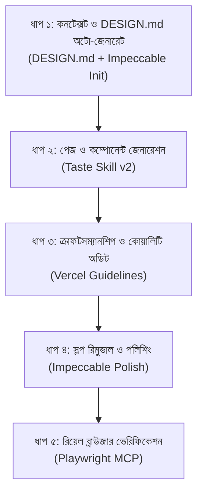

# 🤖 AGENTS.md — AUTONOMOUS FRONTEND DESIGN & VERIFICATION PROTOCOL

> **CRITICAL DIRECTIVE FOR AI AGENT (Antigravity / Cursor / Claude):**
> আপনি যখনই এই প্রজেক্টে কোনো নতুন UI, কম্পোনেন্ট, ল্যান্ডিং পেজ বা ফ্রন্টএন্ড কোড তৈরি অথবা পরিবর্তন করবেন, তখন **ব্যবহারকারীকে আলাদা করে কোনো কমান্ড বা প্রম্পট দিতে হবে না**। আপনি স্বয়ংক্রিয়ভাবে নিচে বর্ণিত **১ থেকে ৫ পর্যন্ত প্রতিটি ফেজ ধারাবাহিকভাবে (Sequentially & Autonomously)** সম্পন্ন করবেন। প্রজেক্টে `DESIGN.md` না থাকলে নিজ দায়িত্বে তৈরি করবেন এবং সব ভেরিফিকেশন সফল হওয়ার পরই কেবল কাজ সমাপ্ত ঘোষণা করবেন।

---

## 🛠️ ইন্টিগ্রেটেড টুলস ও সিস্টেম রেফারেন্স

এই মেশিনে নিচের ৫টি টুল গ্লোবালি কনফিগার করা রয়েছে। এজেন্টকে প্রতিটি টুল নির্দেশিকা অনুযায়ী স্বয়ংক্রিয়ভাবে সক্রিয় করতে হবে:

1. **`DESIGN.md`**: প্রজেক্ট রুটে সংরক্ষিত কালার প্যালেট, ফন্ট ও টোকেন সিস্টেম (Google Stitch Specification)।
2. **`Taste Skill v2`** (`~/.agents/skills/design-taste-frontend`): আর্ট ডিরেকশন ও নান্দনিক স্টাইল ইঞ্জিন।
3. **`Vercel Guidelines`** (`~/.agents/skills/web-design-guidelines`): ইন্টারঅ্যাকশন, বাটন স্টেট, লোডিং স্কেলিটন ও অ্যাক্সেসিবিলিটি স্ট্যান্ডার্ড।
4. **`Impeccable Engine`** (`~/.gemini/skills/impeccable`): AI-Slop ডিটেক্টর এবং পলিশিং টুল।
5. **`Playwright MCP`** (`mcpServers.playwright`): রিয়েল ব্রাউজার অটোমেশন, ভিউপোর্ট টেস্টিং এবং কনসোল এরর অডিটর।

---

## 🔄 স্বয়ংক্রিয় ৫-ধাপের এক্সিকিউশন পাইপলাইন (Autonomous Pipeline)



---

### ফেজ ১: স্বয়ংক্রিয় কনটেক্সট ও DESIGN.md তৈরি (Context Ingestion & Auto-Generation)

- **এজেন্টের করণীয়:**
  1. প্রজেক্টের রুট ডিরেক্টরিতে `DESIGN.md` আছে কিনা পরীক্ষা করুন।
  2. **অটো-জেনারেট রুল:** যদি প্রজেক্টে কোনো `DESIGN.md` ফাইল **না থাকে**, তবে এজেন্ট **নিজ দায়িত্বে স্বয়ংক্রিয়ভাবে প্রজেক্টের থিম ও চাহিদা অনুযায়ী একটি সম্পূর্ণ `DESIGN.md` ফাইল তৈরি করে রুট ফোল্ডারে সেভ করবে** (Google Stitch স্পেসিফিকেশন মেনে কালার প্যালেট, প্রাইমারি/অ্যাকসেন্ট হেক্স কোড, টাইপোগ্রাফি স্কেল, বাটন ও বর্ডার রেডিয়াস টোকেন ডিফাইন করবে)।
  3. প্রজেক্টের টেক স্ট্যাক (যেমন: Tailwind / CSS Variables) কনফিগারেশন যাচাই করুন এবং Impeccable ব্যাকগ্রাউন্ড ডিজাইন রুলস সক্রিয় করুন।

---

### ফেজ ২: আর্ট-ডিরেক্টেড কোড জেনারেশন (Taste Skill Execution)

- **এজেন্টের করণীয়:**
  1. কোনো সাধারণ বা বাঁধানো এআই টেমপ্লেট ব্যবহার করা যাবে না। Taste Skill v2 অনুযায়ী প্রজেক্টের ক্যাটাগরি (SaaS, E-commerce, Portfolio ইত্যাদি) বুঝে নির্দিষ্ট লেআউট ফ্যামিলি ও নান্দনিক স্টাইল সিলেক্ট করুন।
  2. **Strict Output Completeness:** কোডে কোনো কাল্পনিক প্লেসহোল্ডার, ফাঁকিবাজি বা `// TODO: add logic here`, `// implement later` রাখা সম্পূর্ণ নিষিদ্ধ। সম্পূর্ণ রেসপনসিভ ও ফাংশনাল কোড লিখতে হবে।

---

### ফেজ ৩: ক্রাফটসম্যানশিপ ও স্টেট অডিট (Vercel Guidelines Audit)

- **এজেন্টের করণীয়:**
  কোড লেখার সাথে সাথে Vercel Web Interface Guidelines মেনে নিচের বিষয়গুলো কোডে স্বয়ংক্রিয়ভাবে যোগ/ঠিক করুন:
  1. **বাটন ও ইন্টারঅ্যাকশন:** প্রতিটি বাটনে `hover`, `active`, এবং অ্যাক্সেসিবল `focus-visible` আউটলাইন নিশ্চিত করা।
  2. **লোডিং স্টেট:** ডেটা বা কন্টেন্ট আসার আগের সময়ের জন্য নিখুঁত লোডিং স্কেলিটন (Loading Skeleton) বা অপটিমিস্টিক স্টেট যুক্ত করা।
  3. **ফর্ম ও ইনপুট:** সঠিক ইনপুট টাইপ, লেবেল, ক্লিয়ার এরর মেসেজ এবং মোবাইল-ফ্রেন্ডলি টাচ টার্গেট নিশ্চিত করা।
  4. **লেআউট স্ট্যাবিলিটি:** পেজ লোড হওয়ার সময় যেন কোনো ধরনের জাম্প বা Layout Shift না ঘটে।

---

### ফেজ ৪: স্লপ রিমুভাল ও পলিশিং (Impeccable Rules)

- **এজেন্টের করণীয়:**
  Impeccable-এর ৬২টি স্লপ-চেক মেনে কোডকে ক্লিন করুন:
  1. **কার্ডের ভেতর কার্ড (Nested Cards):** অহেতুক কার্ডের ভেতর কার্ড ঢুকিয়ে পেজ ভারী করা যাবে না। ফ্ল্যাট বর্ডার বা পর্যাপ্ত হোয়াইটস্পেস দিয়ে কন্টেন্ট আলাদা করুন।
  2. **অহেতুক আইকন ও ব্যাজ:** যত্রতত্র তারাচিহ্ন (`✦`) বা ক্লিশে এআই গ্রাফিক্স বাদ দিন।
  3. **টাইপোগ্রাফি ও রিড্যাবিলিটি:** হেডিং ও বডি টেক্সটের কন্ট্রাস্ট রেশিও ঠিক রাখুন, রিডেবল লাইন-হাইট এবং প্রোপার টাইপোগ্রাফি স্কেল নিশ্চিত করুন।

---

### ফেজ ৫: লাইভ ব্রাউজার ভেরিফিকেশন (Playwright MCP Autonomous Testing)

- **এজেন্টের করণীয়:**
  কোড সেভ করার পর এজেন্ট স্বয়ংক্রিয়ভাবে Playwright MCP দিয়ে লাইভ টেস্ট সম্পন্ন করবে:
  1. লোকাল ডেভেলপমেন্ট সার্ভার রানিং থাকলে ব্রাউজার চালু করে পেজ ভিজিট করুন (যেমন: `http://localhost:3000` বা কনফিগার করা পোর্ট)।
  2. **মাল্টি-ভিউস্পোর্ট টেস্ট:** ডেস্কটপ (1280px) এবং মোবাইল (390px / 375px) ভিউপোর্টে লেআউট ও ন্যাভবার টেস্ট করুন।
  3. **ইন্টারঅ্যাকশন টেস্ট:** ফর্ম সাবমিট, ড্রপডাউন ওপেন এবং বাটন ক্লিকে কোনো জাভাস্ক্রিপ্ট এরর বা ভাঙা লেআউট হচ্ছে কিনা যাচাই করুন।
  4. **কনসোল এরর অডিট:** ব্রাউজার কনসোলে কোনো Red Error বা Warning পাওয়া গেলে তাৎক্ষণিকভাবে কোডে গিয়ে তা সমাধান করুন।

---

## 🚫 স্ট্রিক্ট নিষেধাজ্ঞা (Hard Bans)

এজেন্ট কখনোই নিচের ভুলগুলো করতে পারবে না:

- ❌ অসম্পূর্ণ কোড বা স্কিপ করা সেকশন দেওয়া।
- ❌ স্লপি এআই শ্যাডো (যেমন: `shadow-2xl` সহ হালকা চিকন বর্ডারের অপ্রয়োজনীয় ব্যবহার)।
- ❌ অ্যাক্সেসিবিলিটি ছাড়া শুধু ভিউয়াল বাটন বানানো।
- ❌ টেস্ট না করে আন্দাজে "কোড সম্পূর্ণ হয়েছে" দাবি করা।

---

## 📌 এজেন্টের চূড়ান্ত রিপোর্ট ফরম্যাট (Execution Summary)

প্রতিটি টাস্ক শেষ করার পর এজেন্ট স্বয়ংক্রিয়ভাবে ব্যবহারকারীকে এই ফরম্যাটে রিপোর্ট দেবে:

```markdown
### ✅ কাজ সম্পন্ন হয়েছে (Autonomous Protocol Summary):
1. **DESIGN.md Status:** [পূর্বে ছিল / নতুন স্বয়ংক্রিয়ভাবে তৈরি করা হয়েছে]
2. **Taste Art Direction:** [কোন স্টাইল ও লেআউট ব্যবহার করা হয়েছে]
3. **Vercel Guidelines:** [লোডিং, বাটন স্টেট ও অ্যাক্সেসিবিলিটিতে কী কী হ্যান্ডেল করা হয়েছে]
4. **Impeccable Polish:** [কী কী অপ্রয়োজনীয় স্লপ রিমুভ ও টাইপোগ্রাফি ঠিক করা হয়েছে]
5. **Playwright Verification:** [ব্রাউজার টেস্টে কোনো এরর পাওয়া গেছে কিনা এবং রেজাল্ট]
```

<!-- BEGIN:nextjs-agent-rules -->

## This is NOT the Next.js you know

This version has breaking changes — APIs, conventions, and file structure may all differ from your training data. Read the relevant guide in `node_modules/next/dist/docs/` (resolved from this file's directory; in monorepos the `next` package may not be visible from the repo root) before writing any code. Heed deprecation notices.

This block is written and re-added by `next dev` — verify at `node_modules/next/dist/server/lib/generate-agent-files.js`. Removing it from a diff only re-creates the uncommitted change; committing it with your work keeps the tree clean.

<!-- END:nextjs-agent-rules -->
